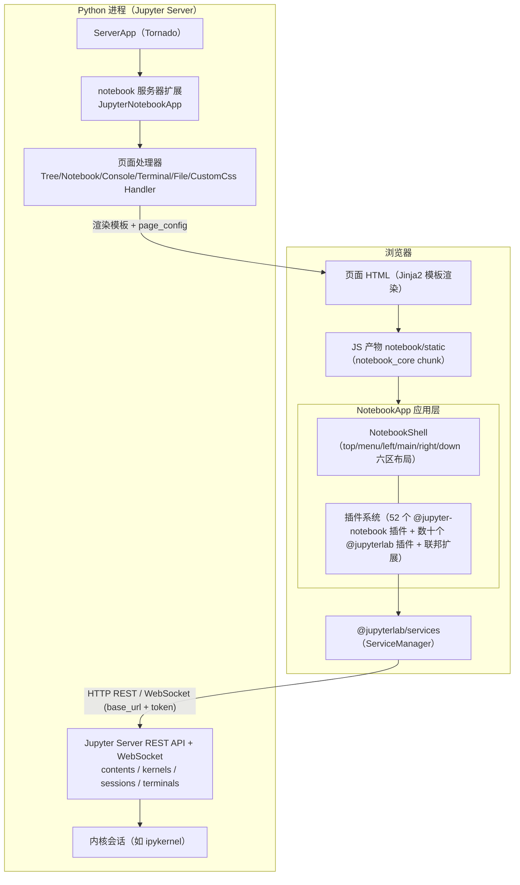
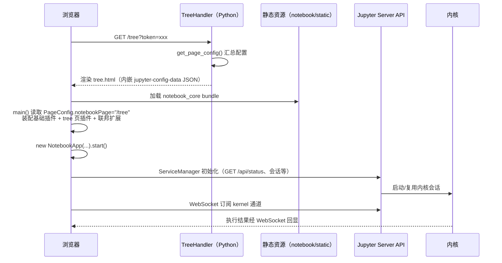

# 整体架构

Notebook v7 的核心架构决策有两个：其一，前端不再自带服务器，而是作为 **Jupyter Server 的服务器扩展**（server extension）挂载；其二，前端不是 JupyterLab 那样的单页应用，而是按经典 Notebook 交互习惯组织的 **多页应用（MPA）**。理解这两点，整个仓库的组织方式就顺理成章。

## 分层架构总览

要点：

- Python 侧只有一个很薄的层（[notebook/app.py](../notebook/app.py)），职责是注册路由、渲染页面模板、注入 `page_config`；所有重能力（内容管理、内核、会话、终端、鉴权）都来自 Jupyter Server 本体。
- 前端复用 JupyterLab 的插件运行时（`JupyterFrontEnd` / `PluginRegistry` / Token 依赖注入），在其上实现自己的 `NotebookApp` 与 `NotebookShell`。

## 多页应用模型

与 JupyterLab 的单页 + 路由不同，Notebook v7 为不同场景生成独立的 HTML 页面。页面清单由 [app/package.json](../app/package.json) 的 `jupyterlab.plugins` 配置驱动：

| 页面路径 | Jinja2 模板（构建后位于 notebook/templates） | 处理器（notebook/app.py） | 用途 |
| --- | --- | --- | --- |
| `/tree` | tree.html | `TreeHandler` | 文件浏览器（Dashboard 首页） |
| `/notebooks` | notebooks.html | `NotebookHandler` | 笔记本编辑页 |
| `/consoles` | consoles.html | `ConsoleHandler` | 控制台页 |
| `/terminals` | terminals.html | `TerminalHandler` | 终端页 |
| `/edit` | edit.html | `FileHandler` | 纯文本/文件编辑页 |
| `/custom/custom.css` | —（直接返回 CSS） | `CustomCssHandler` | 用户自定义样式 |
| 错误页 | error.html | — | 404 等错误渲染 |

每个页面加载同一套核心 bundle，但按 `notebookPage` 页面标识装配不同的插件集合（见下文"按页面装配"）。

## 一次页面加载的完整生命周期

几个关键衔接点：

1. **page_config 注入**：后端把 `baseUrl`、`token`、`appVersion`、`terminalsAvailable`、MathJax 地址、JupyterHub 元数据等写入页面里的 `<script id="jupyter-config-data">` JSON；前端 `PageConfig` 读取它完成初始化。生成逻辑见 [NotebookBaseHandler.get_page_config](../notebook/app.py)（详解见 [05-关键类与函数](05-关键类与函数.md)）。
2. **前端引导**：[app/index.template.js](../app/index.template.js) 的 `main()` 是整个前端的引导函数，按页面拼装插件、加载联邦扩展、实例化 `NotebookApp`。
3. **数据通道**：前端不直接访问文件系统或内核，全部通过 `@jupyterlab/services` 走 Jupyter Server 的 REST + WebSocket 接口。

## 插件体系

前端功能以 `JupyterFrontEndPlugin` 为单位组织（JupyterLab 的约定），本仓库在其上叠加了自己的 Token 与插件包：

- **声明**：每个插件是含 `id`、`description`、`autoStart`、`requires`/`optional`/`provides`、`activate` 的对象；`activate(app, ...services)` 在依赖满足后被调用。
- **依赖注入**：服务通过 Lumino `Token` 标识，如本仓库自定义的 `INotebookShell`、`INotebookPathOpener`、`INotebookTree`；插件间依赖在 `PluginRegistry` 中解析。
- **数量**：`packages/` 下 9 个扩展包共声明 52 个插件（统计自各包 `src/index.ts` 中的 `id` 字段），其中 application-extension 23 个、notebook-extension 12 个为最大两块。

### 按页面装配插件

[app/package.json](../app/package.json) 中 `jupyterlab.plugins` 以页面为键声明插件白名单：

- `"/"`：所有页面共享的基础插件（应用外壳、菜单、命令面板、主题、翻译、文件打开器、notebook/terminal/console 的工厂等），既有 `@jupyter-notebook/*` 包，也大量精选了 `@jupyterlab/*` 包中的子插件（数组形式表示从包中挑选指定 id 的插件）。
- `"/tree"`：追加文件浏览器全量插件、运行中的内核与会话面板、设置编辑器、扩展管理器、`@jupyter-notebook/tree-extension`。
- `"/notebooks"`：追加调试器（debugger-extension）、目录（toc-extension）、单元格标签、元数据表单、tooltip 等。
- `"/consoles"`：追加控制台的 tooltip。
- `"/edit"`：追加文件编辑器的补全与搜索、Markdown 预览。

构建时 rspack 用 Handlebars 把这份配置编译进 `index.js`（见 [04-前端模块详解](04-前端模块详解.md) 的 app 一节）；运行时按 `PageConfig.getOption('notebookPage')` 选择分支。同一 bundle 因此可以为不同页面裁剪功能，同时 `PageConfig.setOption('allPlugins', ...)` 把全量插件清单暴露给设置编辑器，使跨页面的插件也能被配置。

## 联邦扩展机制

Notebook v7 通过 **rspack Module Federation** 支持第三方预构建扩展（pip 安装的 JupyterLab 扩展）动态加载：

- 核心包构建为联邦容器 `CORE_FEDERATION`，挂到全局 `window._JUPYTERLAB`（见 [app/rspack.config.js](../app/rspack.config.js)）；`@jupyterlab/*`、`@lumino/*`、`react`、`yjs` 等约 60 个包声明为 singleton 共享依赖，保证核心与扩展实例唯一。
- 引导代码读取 page_config 中的 `federated_extensions` 清单，动态 `<script>` 加载各扩展的 remote entry，经 `__webpack_init_sharing__` 共享作用域后取出插件模块注册进应用。
- 被禁用的扩展不参与启动，而是在应用 `restored` 且浏览器空闲后延迟加载，仅用于在设置界面中登记元数据。

`@jupyter-notebook/lab-extension`（见 [04-前端模块详解](04-前端模块详解.md)）本身也以预构建扩展形式构建到 `notebook/labextension/`，使 JupyterLab 用户可以安装并切换到 Notebook 界面——这体现了 v7 "Notebook 与 Lab 共享组件、可互嵌"的设计。

## 服务器扩展挂载方式

Python 侧的接入点有三处，共同构成"pip 安装即生效"的体验：

1. [notebook/__init__.py](../notebook/__init__.py) 提供 `_jupyter_server_extension_points()`，把 `notebook.app.JupyterNotebookApp` 登记为扩展应用。
2. [jupyter-config/jupyter_server_config.d/notebook.json](../jupyter-config/jupyter_server_config.d/notebook.json) 写入 `ServerApp.jpserver_extensions: {"notebook": true}`，安装时经 wheel `shared-data` 落到 `etc/jupyter/` 下，ServerApp 启动时自动发现并启用。
3. `JupyterNotebookApp` 继承 `LabServerApp`（来自 jupyterlab_server），自动获得 labextension 静态资源服务、schema/设置目录管理能力；再通过 `notebook_shim` 的 `NotebookConfigShimMixin` 兼容一批 v6 时代的 traitlets 配置项。
