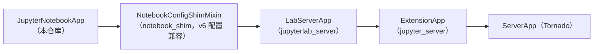

# 后端模块详解

Python 侧代码集中在 [notebook/](../notebook/) 包中，体量很小（不含静态资源只有 4 个模块），因为它把服务器能力全部委托给 Jupyter Server，自己只做三件事：注册扩展、定义页面路由、生成页面配置。

## 模块清单

| 模块 | 行数规模 | 职责 |
| --- | --- | --- |
| [notebook/app.py](../notebook/app.py) | ~370 行 | 扩展应用 `JupyterNotebookApp`、6 个页面处理器、`page_config` 生成 |
| [notebook/__init__.py](../notebook/__init__.py) | ~20 行 | 服务器扩展与 labextension 的发现入口 |
| [notebook/__main__.py](../notebook/__main__.py) | 7 行 | `python -m notebook` CLI 入口，转调 `notebook.app.main` |
| [notebook/_version.py](../notebook/_version.py) | ~40 行 | `__version__ = "7.7.0a2"` 与 `version_info` 命名元组（PEP 440 解析） |

另有随包分发的静态资产（构建产物，不在源码管理中生成）：`notebook/static/`（前端 bundle）、`notebook/templates/`（构建生成的页面模板）、`notebook/labextension/`（预构建扩展）、`notebook/schemas/@jupyter-notebook/`（设置 schema）、`notebook/custom/custom.css` 示例样式。

## 扩展发现：notebook/__init__.py

```python
def _jupyter_server_extension_points() -> list[dict[str, Any]]:
    from .app import JupyterNotebookApp
    return [{"module": "notebook", "app": JupyterNotebookApp}]

def _jupyter_labextension_paths() -> list[dict[str, str]]:
    return [{"src": "labextension", "dest": "@jupyter-notebook/lab-extension"}]
```

- `_jupyter_server_extension_points` 被 Jupyter Server 的扩展管理器调用；采用延迟导入 `JupyterNotebookApp`，避免包导入期就拉起重量级依赖。
- `_jupyter_labextension_paths` 声明预构建扩展位置，供 JupyterLab 的扩展管理器发现。

配合 [jupyter-config/jupyter_server_config.d/notebook.json](../jupyter-config/jupyter_server_config.d/notebook.json)（`jpserver_extensions: {"notebook": true}`），用户 `pip install notebook` 后无需手工启用即可使用。

## 核心应用：JupyterNotebookApp

定义于 [notebook/app.py](../notebook/app.py)，继承链为：



关键职责与行为：

| 成员 | 说明 |
| --- | --- |
| `name = "notebook"` | 扩展标识，也是配置命名空间（`c.NotebookApp` 之外的扩展级配置） |
| `default_url = "/tree"` | 访问 `/` 时重定向到文件树页 |
| `extension_url = "/"`、`file_url_prefix = "/tree"` | 扩展根路径与文件 URL 前缀 |
| `expose_app_in_browser`（Bool, config） | 是否把前端全局应用实例暴露为 `window.jupyterapp`，对应 CLI flag `--expose-app-in-browser` |
| `custom_css`（Bool, config） | 是否在页面模板中加载自定义 CSS（`/custom/custom.css`），对应 flag `--custom-css` |
| 各 `@default` 目录属性 | `static_dir` → `notebook/static`；`templates_dir` → `notebook/templates`；`app_settings_dir`/`schemas_dir`/`themes_dir` → JupyterLab 的 app 目录；`user_settings_dir`/`workspaces_dir` → `jupyterlab.commands` 提供的用户目录 |
| `initialize_handlers()` | 注册 6 条页面路由（见下表），并把 `nbclassic_enabled`、JupyterHub 元数据（`hubPrefix`、`hubUser`、`shareUrl` 等，且出于安全清空 `token`）写入 `page_config` |
| `make_serverapp()`（classmethod） | 把本扩展的 flags 合并进 ServerApp 的命令行解析（因为 jupyter_server 只合并 aliases 不合并 flags） |
| `_prepare_templates()` | 向 Jinja2 环境注入 `custom_css` 全局变量，供模板条件加载样式 |
| `server_extension_is_enabled(extension)` | 查询其它服务器扩展（如 nbclassic）是否启用 |

模块底部 `main = launch_new_instance = JupyterNotebookApp.launch_instance` 同时是 `jupyter-notebook` 命令（pyproject 中 `project.scripts`）与 `python -m notebook` 的入口。

## 页面处理器

所有处理器继承 `NotebookBaseHandler`（mixin 链：`ExtensionHandlerJinjaMixin` + `ExtensionHandlerMixin` + `JupyterHandler`，获得扩展上下文与 Jinja2 渲染能力）：

| 处理器 | 路由（`initialize_handlers` 中注册） | 行为 |
| --- | --- | --- |
| `TreeHandler` | `/tree(.*)` | 目录 → 渲染 tree.html（写入 `treePath`）；是 `.ipynb` 文件 → 302 到 `/notebooks/...`；其它文件 → 302 到 `/files/...`（原始内容）；隐藏目录且 `allow_hidden=False` → 404 |
| `NotebookHandler` | `/notebooks(.*)` | 路径是目录 → 302 回 `/tree/...`；否则渲染 notebooks.html |
| `ConsoleHandler` | `/consoles/(.*)` | 渲染 consoles.html |
| `TerminalHandler` | `/terminals/(.*)` | 渲染 terminals.html |
| `FileHandler` | `/edit(.*)` | 渲染 edit.html |
| `CustomCssHandler` | `/custom/custom.css` | 返回 `jupyter_config_dir()/custom/custom.css`；不存在则回退到静态目录旁的 custom 目录 |

所有 `get` 均带 `@web.authenticated` 鉴权。`TreeHandler.get` 与 `NotebookHandler.get` 的互相重定向保证了"目录看树、文件看内容"的经典 Dashboard 行为。

## NotebookBaseHandler.get_page_config()

这是前后端之间最重要的数据契约，生成的字典字段包括：

| 字段 | 来源/含义 |
| --- | --- |
| `appVersion` | Python 包版本 |
| `baseUrl` / `token` | 服务地址与鉴权 token |
| `terminalsAvailable` | 服务器是否支持终端 |
| `fullStaticUrl` | 静态资源地址（`{base_url}/static/notebook`） |
| `frontendUrl` | 前端根（`{base_url}/`） |
| `exposeAppInBrowser` | 是否暴露 `window.jupyterapp` |
| `preferredPath` | 相对 server 根的首选目录（用于 Tree 页定位） |
| `mathjaxConfig` / `fullMathjaxUrl` | MathJax 渲染配置（默认 CDN 2.7.7） |
| `jupyterConfigDir` | Jupyter 配置目录（供 custom.css 定位） |
| LabConfig 全部 trait | `LabServerApp` 的配置项经 `_camelCase` 转驼峰后整体并入（如 `appSettingsDir`） |
| `*_url` 全量地址 | 所有以 `_url` 结尾的配置再生成一份 `full*Url`（拼上 base_url） |
| federated 扩展数据 | 经 `jupyterlab_server.config.get_page_config` 递归合并（扫描 labextensions 路径） |
| `nbclassic_enabled` / hub 元数据 | 在 `initialize_handlers` 中补充 |

还支持 `page_config_hook` 设置项（settings 中的可调用对象）对最终配置做最后加工，为部署方留出钩子。

## 打包与分发（pyproject.toml）

- **构建后端**：hatchling；`hatch-jupyter-builder` + `jupyter-builder` 钩子在构建 wheel 时调用 `jlpm build:prod:release`，产物写入 `notebook/static/`（`ensured-targets` 校验 `labextension/static/style.js`），前端因此无需发布 npm 包即可随 pip 分发。
- **wheel shared-data**：
  - `notebook/labextension` → `share/jupyter/labextensions/@jupyter-notebook/lab-extension`
  - `notebook/schemas/@jupyter-notebook` → `share/jupyter/lab/schemas/@jupyter-notebook`
  - `jupyter-config/jupyter_server_config.d` → `etc/jupyter/jupyter_server_config.d`（自动启用）
  - `notebook.svg` 与 `jupyter-notebook.desktop` → 系统图标与桌面入口
- **命令入口**：`jupyter-notebook = "notebook.app:main"`。
- **质量配置**：mypy strict（files = notebook）、ruff（line-length 100，启用 bugbear/pylint/security 等大量规则集）、pytest（testpaths=tests/，timeout 300，warnings 转错误）。
