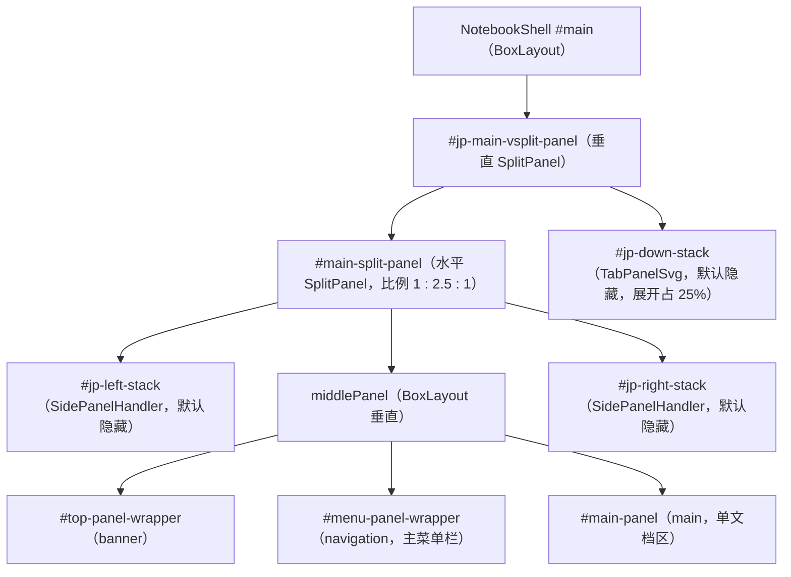

# 关键类与函数

本文按后端、前端、引导流程三部分，对源码中承担核心职责的类与函数做方法级说明。行号以当前仓库源码为准。

## 后端（notebook/app.py）

### JupyterNotebookApp

扩展应用主类（[notebook/app.py](../notebook/app.py)），实例化为单例驱动整个前端服务。

| 成员 | 签名/类型 | 说明 |
| --- | --- | --- |
| `name` | `str = "notebook"` | 扩展标识；Jupyter Server 扩展管理器据此加载 |
| `default_url` | `Unicode("/tree", config=True)` | `/` 的重定向目标，可被用户配置覆盖 |
| `expose_app_in_browser` | `Bool(False, config=True)` | 控制浏览器端是否可访问 `window.jupyterapp` |
| `custom_css` | `Bool(True, config=True)` | 模板是否加载 `/custom/custom.css` |
| `_default_static_dir` 等 `@default` | `-> str` | 默认目录集合：`static_dir=HERE/static`、`templates_dir=HERE/templates`、`app_settings_dir/schemas_dir/themes_dir` 指向 JupyterLab app 目录、`user_settings_dir/workspaces_dir` 用 `jupyterlab.commands` 的跨平台实现 |
| `_prepare_templates` | `() -> None` | 调用祖父类实现后，向 Jinja2 全局注入 `custom_css` 变量 |
| `server_extension_is_enabled` | `(extension: str) -> bool` | 容错地查询 `serverapp.extension_manager` 中某扩展的启用状态 |
| `initialize_handlers` | `() -> None` | 注册 6 条路由；写入 `nbclassic_enabled`；若检测到 JupyterHub（`hub_prefix` in tornado_settings）则补充 `hubPrefix/hubHost/hubUser/shareUrl/hubServerName` 并清空 page_config 中的 `token`（token 属于服务端身份，不能下发给 Hub 场景的浏览器） |
| `make_serverapp` | `classmethod (**kwargs) -> ServerApp` | 把扩展 flags 并入 ServerApp 命令行解析器（修复 jupyter_server 只合并 aliases 的行为） |
| `initialize` | `(argv=None) -> None` | 适配 `ExtensionApp.initialize()` 无参签名 |
| `main` / `launch_new_instance` | 模块级 | `JupyterNotebookApp.launch_instance` 别名，CLI 入口 |

### NotebookBaseHandler 与 get_page_config

`NotebookBaseHandler` 是 6 个处理器的公共基类，核心是 `get_page_config() -> dict`，其组装顺序（各来源依次覆盖/合并）：

1. 以 settings 中的 `page_config_data`（其它扩展可写入）为底；
2. 注入 `appVersion`、`baseUrl`、`token`、`terminalsAvailable`、`fullStaticUrl`、`frontendUrl`、`exposeAppInBrowser`、`preferredPath`（相对 server 根计算，异常回退 `/`）；
3. 设置 MathJax 配置与完整 URL（相对路径自动拼 base_url）；
4. 遍历 `LabConfig()` 的全部 trait 名，把应用配置驼峰化并入，并为 `*_url` 结尾项追加 `full*Url`；
5. 用 `jupyterlab_server.config.get_page_config` 合并 federated 扩展的 page_config（`recursive_update`）；
6. 若 settings 提供 `page_config_hook`，最后回调加工。

### TreeHandler.get 与 NotebookHandler.get 的路由决策

- `TreeHandler.get(path)`：`path` 为目录且非隐藏 → 渲染 `tree.html`（page_config 额外带 `treePath`）；为 `.ipynb` → redirect `/notebooks/{path}`；为其它文件 → redirect `/files/{path}`（原始文件服务）；隐藏目录且不允许 → 404。
- `NotebookHandler.get(path)`：`path` 为目录 → redirect `/tree/{path}`；否则渲染 `notebooks.html`。

二者配合实现"目录与文件互跳"，测试 [tests/test_app.py](../tests/test_app.py) 中对重定向行为有精确断言。

## 前端（packages/application）

### NotebookApp

[src/app.ts](../packages/application/src/app.ts)，整个浏览器应用的单例入口。

构造函数流程：

1. `super({...options, shell: options.shell ?? new NotebookShell()})` —— 无显式 shell 时创建默认外壳；
2. `docRegistry.addModelFactory(new Base64ModelFactory())` —— 注册 base64 文件模型工厂；
3. 若传入 `mimeExtensions`，经 `createRendermimePlugins` 生成渲染插件并注册；
4. 以 `JupyterLab.defaultInfo` 为底组装 `IInfo`（`availablePlugins`、`disabled`），连接 `availablePluginsAdded` 信号以支持启动后再发现的插件；
5. `this.restored = this.shell.restored`，restored 后节流执行格式探测。

| 成员 | 说明 |
| --- | --- |
| `name = 'Jupyter Notebook'`、`namespace` | 应用名与插件命名空间 |
| `status: LabStatus` | busy/dirty 状态信号（复用 JupyterLab 实现） |
| `version` | 读 `PageConfig.getOption('appVersion')` |
| `info: IAppInfo` | 可用插件列表 + `availablePluginsChanged` 信号 |
| `paths: JupyterFrontEnd.IPaths` | 从 PageConfig 汇总的 8 类 URL 与 9 类目录（settings/themes/schemas/serverRoot 等） |
| `handleEvent(event)` | 额外监听 `resize`，节流 250ms 后调用 `Private.setFormat` |
| `registerPluginModule(mod)` / `registerPluginModules(mods)` | 注册 CommonJS/ES 模块导出的一个或多个插件，单个失败不影响其余（console.error） |
| `Private.setFormat(app)` | `matchMedia('only screen and (max-width: 760px)')` 命中则 `format='mobile'`，否则 `'desktop'` |

### NotebookShell

[src/shell.ts](../packages/application/src/shell.ts)，实现 `JupyterFrontEnd.IShell`，用 Lumino 容器组成如下 DOM 结构（id 即选择器，可对照 CSS 调试）：

与 JupyterLab Shell 的本质差异：`main` 区是普通 `Panel` 而非多标签 dock，当前部件取 `_main.widgets[0]`，即"单文档 + 侧栏"的经典 Notebook 布局。

关键方法：

| 方法 | 说明 |
| --- | --- |
| `add(widget, area, options)` | 先查 `userLayout`（按 `options.type` 或 widget id）覆盖目标区域与选项；`rank` 缺省 900。`top/menu/left/right` → 对应 PanelHandler 按 rank 排序插入；`down` → 加入底部 TabPanel；`main`（或未指定）→ **单文档约束**：主区已有部件时直接忽略，否则插入并发出 `currentChanged`、resolve `_mainWidgetLoaded` |
| `activateById(id)` | 按 `main → top → left → right → menu → down` 顺序查找部件；left/right 走 `expandLeft/expandRight`，down 选中对应标签并按需显示面板，其余直接 `widget.activate()` |
| `expand(area)` / `collapse(area)` | 展开或折叠指定区域；`expandTop`/`collapseTop`、`expandLeft`/`collapseLeft`、`expandRight`/`collapseRight` 为便捷封装 |
| `isSidePanelVisible(area)` / `getWidgetArea(id)` | 查询侧栏可见性；反查某部件所在区域 |
| `restoreLayout()` | 恢复默认布局（折叠 side/down，仅保留 main） |
| `userLayout` | `INotebookShell.IUserLayout`：`{widgetId: {area, options}}` 映射，允许用户经 `shell.json` 设置把部件改放到其它区域 |
| `restored: Promise<void>` | 布局恢复完成信号，`NotebookApp.restored` 直接透传 |

### PanelHandler 与 SidePanelHandler

[src/panelhandler.ts](../packages/application/src/panelhandler.ts)：

- `PanelHandler`：维护 `{widget, rank}` 有序数组（`ArrayExt.upperBound` 二分插入），部件移除时经 MessageLoop 钩子同步清理 —— top/menu 区的排序容器。
- `SidePanelHandler`：组合 `StackedPanel`（同时只有一个部件可见）+ 关闭按钮 + 活动标签栏；`expand(id)` 切换当前部件并显示面板，`collapse()` 隐藏面板但保留部件 —— left/right 侧栏的行为来源。

### NotebookTreeWidget 与 INotebookTree

[tree/src/notebook-tree.ts](../packages/tree/src/notebook-tree.ts)：`NotebookTreeWidget extends TabPanel`（顶部标签、可拖动、`TabBarSvg` 渲染器，class `jp-TreePanel`）。`INotebookTree` Token（`@jupyter-notebook/tree:INotebookTree`）让 tree-extension 的 `widget` 插件向使用方暴露该容器，其它插件（文件浏览器、设置编辑器、运行会话面板）据此把自己的视图作为标签页挂进来。

### DefaultNotebookPathOpener

[src/pathopener.ts](../packages/application/src/pathopener.ts)：实现 `INotebookPathOpener.open({prefix, path, searchParams, target, features})`，用 `URLExt.join` + `encodeParts` 拼地址后 `window.open` 新开标签。导出的单例 `defaultNotebookPathOpener` 由 `application-extension:path-opener` 插件注册到 Token；下游可提供自己的实现替换（例如在 iframe 场景改用当前窗口导航）。

### 自定义 Token 一览

| Token | 定义处 | 用途 |
| --- | --- | --- |
| `INotebookShell`（`@jupyter-notebook/application:INotebookShell`） | [shell.ts](../packages/application/src/shell.ts) | 替代 JupyterLab 的 `ILabShell`，插件据此操作六区布局 |
| `INotebookPathOpener` | [tokens.ts](../packages/application/src/tokens.ts) | 覆盖"打开路径"行为 |
| `INotebookTree`（`@jupyter-notebook/tree:INotebookTree`） | [tree/src/token.ts](../packages/tree/src/token.ts) | 访问 Tree 页主区容器 |

## 前端引导流程（app/index.template.js）

[app/index.template.js](../app/index.template.js) 的 `main()` 在 `window load` 事件后执行，是理解前端启动的钥匙（构建后其中的 Handlebars 占位符已被展开为具体 require 语句）：

1. 组装 `mimeExtensionsMods`（javascript/json/pdf/vega5 渲染扩展）；
2. 组装 `baseMods`：`"/"` 页基础插件 + 按 `PageConfig.getOption('notebookPage')` 追加当前页面插件；
3. 解析 `federated_extensions` page_config，`loadComponent()` 逐个动态加载远程扩展脚本并初始化共享作用域（`__webpack_init_sharing__`）；被禁用的扩展推入延迟队列；
4. `activePlugins()` 生成器过滤禁用项（支持按插件 id 与按扩展包名两级禁用，包级禁用会输出警告），产出 `mods`、`mimeExtensions`、`disabled`、`availablePlugins`；
5. `PageConfig.setOption('allPlugins', ...)` 登记全量插件清单（供设置编辑器显示未加载页面的插件）；
6. `new PluginRegistry()` → `registerPlugins(mods)` → `resolveRequiredService(IServiceManager)` 先行解析服务管理器；
7. `new NotebookApp({pluginRegistry, serviceManager, mimeExtensions, disabled, availablePlugins, availablePluginsAdded})`；若 page_config 的 `exposeAppInBrowser` 为真则挂 `window.jupyterapp`；
8. `await app.start()`；`restored` 且浏览器空闲后加载被禁用联邦扩展的元数据，经 `availablePluginsAdded` 信号并入应用信息。

辅助函数 `loadScript`/`loadComponent`/`createModule` 处理 Module Federation 远程模块的加载与 scope 标记；`whenIdle` 兼容不支持 `requestIdleCallback` 的浏览器。
