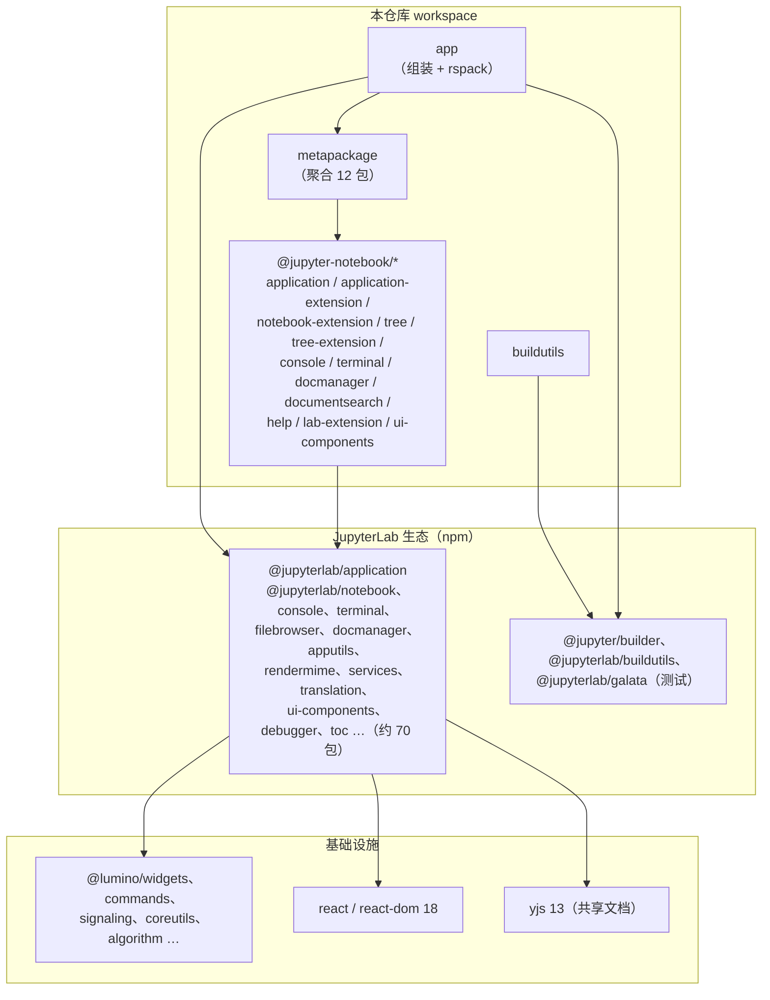

# 依赖关系

本文梳理三类依赖：Python 运行时依赖、前端包依赖（含 monorepo 内部依赖与生态依赖）、构建/开发工具链依赖。

## Python 运行时依赖

来自 [pyproject.toml](../pyproject.toml) 的 `dependencies`：

| 依赖 | 版本约束 | 在本仓库中的角色 |
| --- | --- | --- |
| `jupyter_server` | ≥2.19.0，<3 | HTTP 服务器本体：ServerApp、Tornado、REST/WebSocket API、扩展框架、pytest 插件 |
| `jupyterlab` | ≥4.7.0a2，<4.8 | 提供 `jupyterlab.commands` 的目录工具（app/settings/schemas/themes/workspaces 路径计算）以及 npm 侧组件的对齐版本 |
| `jupyterlab_server` | ≥2.28.0，<3 | `LabServerApp` 基类（JupyterNotebookApp 的父类）、page_config 生成、设置 API 处理器 |
| `notebook_shim` | ≥0.2，<0.3 | `NotebookConfigShimMixin`：兼容 v6 的 traitlets 配置（如 MathJax、终端可用性等） |
| `tornado` | ≥6.2.0 | Web 层（经 jupyter_server 传递使用，handler 中直接引用 `tornado.web`） |
| `jupyter-builder` | ≥1.1.1，<2 | pip 构建期钩子：调用 jlpm 构建前端（`hatch-jupyter-builder` 桥接） |

可选依赖组：`test`（pytest、nbval、ipykernel、jupyter_server[test] 等）、`docs`（Sphinx 系）、`dev`（pre-commit、hatch）。

## 前端依赖分层

分层规则：

- **app → metapackage → 12 个功能包**：`app` 的 dependencies 直接列出全部 `@jupyter-notebook/*`（lab-extension 除外，经 workspace build 脚本单独构建），`metapackage` 再聚合一次用于 `jlpm build:lib` 的统一 tsc 编译（见 [07-构建与运行](07-构建与运行.md)）。
- **@jupyter-notebook/* → @jupyterlab/***：本仓库的包几乎不直接写 UI 组件，而是复用 JupyterLab 的部件与插件（`@jupyterlab/notebook` 的 NotebookPanel、`@jupyterlab/filebrowser` 等），只做"重新装配 + 经典交互适配"。
- **@jupyterlab/* → @lumino/* + react + yjs**：Lumino 提供窗口部件/命令/信号等底层抽象，React 用于部分组件渲染，yjs 支撑实时协同文档模型。

## monorepo 内部依赖细节

- 各功能包在 `package.json` 中以 `^7.7.0-alpha.2` 互相引用（如 notebook-extension 依赖 application、tree 等），由 Yarn workspace 解析为本地链接。
- [app/package.json](../app/package.json) 的 `resolutions` 字段钉死约 120 个包的精确版本（全部 `@jupyterlab/*`、`@lumino/*`、react、yjs、codemirror），这是 Module Federation 共享依赖的版本基准。
- `singletonPackages` 列表（约 60 项）声明必须全局单例的包：两份 `@lumino/widgets` 或 react 实例会导致部件系统崩溃，构建时对这些包追加 `singleton: true` 共享配置（见 [app/rspack.config.js](../app/rspack.config.js) 的 `createShared`）。
- 根 package.json 另有全局 resolutions：`@types/react ^18.0.26`、`react ^18.2.0`、`yjs ^13.5.40`。

## 与 Jupyter 生态其它部分的关系

| 组件 | 关系 |
| --- | --- |
| Jupyter Server | 宿主：notebook 是其服务器扩展；所有 API（contents/kernels/sessions/terminals/settings）由其提供 |
| JupyterLab | 前端组件供应方 + 互嵌对象：Notebook 可在 Lab 中运行（lab-extension），Lab 的预构建扩展也能装进 Notebook（联邦扩展机制） |
| jupyterlab_server | `LabServerApp`、设置 schema 服务、page_config 工具的直接来源 |
| notebook_shim | v6 → v7 配置兼容垫片，`JupyterNotebookApp` 通过 mixin 继承其行为 |
| JupyterHub | `initialize_handlers` 检测 Hub 环境并注入 `hubPrefix` 等元数据；前端 `paths` 暴露 hubHost/hubPrefix/hubUser |
| ipykernel | 典型内核（仅测试依赖中出现），经 Jupyter Server 的 kernel 会话间接使用 |
| nbclassic | 界面切换器的一个可选项（依据 `nbclassic_enabled` 动态显示） |

## 构建与工具链依赖

| 工具 | 用途 | 声明位置 |
| --- | --- | --- |
| yarn 3.5.0（jlpm） | workspace 包管理 | 根 package.json `packageManager` |
| rspack 2.x（@rspack/cli、@rspack/core） | 前端打包（替代 webpack） | app/package.json |
| @jupyter/builder | labextension 构建器（jupyter-builder 命令）、webpack 基础配置 | app、lab-extension devDependencies |
| typescript ~5.9.3 | 全部 TS 编译 | 各包 |
| hatchling + hatch-jupyter-builder + jupyter-builder | Python 构建后端与前端构建钩子 | pyproject build-system |
| eslint 9（flat config）+ @jupyter/eslint-plugin + prettier | JS/TS 代码规范 | 根 package.json、[eslint.config.mjs](../eslint.config.mjs) |
| jest 29 + ts-jest | 前端单元测试 | application、ui-components 包 |
| Playwright + @jupyterlab/galata | 端到端测试 | [ui-tests/package.json](../ui-tests/package.json) |
| pytest 系 + ruff + mypy(strict) + pre-commit | Python 测试与静态检查 | pyproject.toml、[.pre-commit-config.yaml](../.pre-commit-config.yaml) |
| jupyter-releaser | 发布流程编排 | pyproject `[tool.jupyter-releaser]` |

## 版本对齐策略

- Python 依赖 `jupyterlab>=4.7.0a2,<4.8` 与 npm 侧 `~4.7.0-alpha.2` 保持同代：前端包内联使用的 JupyterLab API 必须与运行时安装的 JupyterLab 版本兼容。
- `buildutils` 提供 `upgrade-lab-dependencies` 脚本批量同步两边的 `@jupyterlab/*` 版本，升级依赖后用 `jlpm integrity`（ensure-repo.ts）校验仓库一致性。
