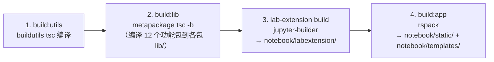

# 构建与运行

本文覆盖四种场景：终端用户安装运行、开发环境搭建与日常开发、构建管线内部原理、发布流程。

## 终端用户：安装与运行

```bash
pip install notebook
jupyter notebook          # 等价命令：jupyter-notebook
```

启动后 ServerApp 监听默认 8888 端口，浏览器打开 `http://localhost:8888/tree` 进入文件树页。远程服务器部署（token、证书、反代等）遵循 [Running a notebook server](https://jupyter-server.readthedocs.io/en/latest/operators/public-server.html) 的通用配置，因为 v7 的服务器就是 Jupyter Server。

常用 CLI 旗标（本仓库新增，见 [notebook/app.py](../notebook/app.py)）：

| 旗标 | 作用 |
| --- | --- |
| `--expose-app-in-browser` | 浏览器控制台可经 `window.jupyterapp` 访问应用实例（调试用） |
| `--custom-css` | 加载 `~/.jupyter/custom/custom.css`（默认已开启，可显式关闭） |

## 开发环境搭建

前置要求：Python ≥ 3.11 与 NodeJS（任选 venv/uv/conda/mamba 创建环境）。以下命令来自 [CONTRIBUTING.md](../CONTRIBUTING.md)：

```bash
# 1. 安装 Python 包（可编辑模式 + 全部可选依赖）
pip install -e ".[dev,docs,test]"

# 2. 安装 JS 依赖并构建全部 workspace 包
jlpm install
jlpm build

# 3. 链接 notebook 扩展与 @jupyter-notebook schema 到 Jupyter 数据目录
jlpm develop

# 4. 确认服务器扩展已启用（pip 安装的配置片段默认已启用）
jupyter server extension enable notebook

# 5. 启动
jupyter notebook
```

日常开发的增量模式：

```bash
jlpm watch        # 并行 watch:lib（metapackage tsc -w）与 watch:app（rspack --watch）
```

watch 模式下修改 `packages/` 或 `app/` 源码会自动重建 `notebook/static`，浏览器刷新即生效（无需重启 Python 进程，除非改了后端代码）。

### 依赖本地未发布的 JupyterLab 包（yalc 流程）

`CONTRIBUTING.md` 记录了用 yalc 测试未发布依赖的做法：在依赖包目录 `yalc publish` → 本仓库 `yalc add <pkg>` 并把 dependencies 中的条目手工移到 `resolutions` → `jlpm install && jlpm build`；依赖更新时 `jlpm build && yalc push` 推送。需注意两侧共同依赖（如 `@jupyterlab/coreutils`）版本一致，否则构建报错。

## 构建管线原理

`jlpm build`（根 [package.json](../package.json)）串联四步：



各步细节：

1. **buildutils**：`tsc` 编译仓库脚本到 `buildutils/lib/`。
2. **metapackage**：`tsc -b` 借助项目引用（tsconfig project references）级联编译全部功能包，产物是各包 `lib/` 下的 JS + d.ts。
3. **lab-extension**：[packages/lab-extension](../packages/lab-extension/package.json) 用 `jupyter-builder build .`（生产模式 `build:labextension`）产出 JupyterLab 预构建扩展到 `../../notebook/labextension`；这是随 pip 分发、供 JupyterLab 侧安装使用的产物。
4. **app**：[app/rspack.config.js](../app/rspack.config.js)：
   - Handlebars 把 [index.template.js](../app/index.template.js) 按 `jupyterlab.plugins` 配置编译为 `build/index.js`，并写一个仅 `import("./index.js")` 的 bootstrap 入口；
   - `Build.ensureAssets`（@jupyter/builder）收集各扩展包的样式与 schema，schema 输出到 `notebook/schemas/@jupyter-notebook`；
   - HtmlWebpackPlugin 以 [app/templates](../app/templates/) 的 6 个骨架渲染出 `notebook/templates/{consoles,edit,error,notebooks,terminals,tree}.html`；
   - rspack 打包输出到 `notebook/static/`，核心 chunk 命名 `notebook_core`（`@jupyterlab|@jupyter-notebook|@lumino` 模块归入），同时以 `library: ['_JUPYTERLAB','CORE_OUTPUT']` 暴露联邦容器 `CORE_FEDERATION`；
   - `--analyze` 环境下追加 BundleAnalyzerPlugin。

生产变体：`build:prod`（无压缩）、`build:prod:minimize`（压缩）、`build:prod:release`（发布，含 license 处理）。根 scripts 的 `build:*` 系列都会前置 `build:utils`。

### Python 侧构建钩子

pip 安装（或 `pip install -e .`）时 [pyproject.toml](../pyproject.toml) 的 hatch 钩子自动触发前端构建，因此源码检出后仅 `pip install -e .` 也能得到完整可运行产物：

| 场景 | build_cmd | 产物目录 |
| --- | --- | --- |
| 正常安装（wheel/sdist 构建） | `build:prod:release` | `notebook/static`（ensured-targets 校验 `labextension/static/style.js`） |
| 可编辑安装（`pip install -e .`） | `build` | `notebook/static` |

### 目录去向速查

| 构建产物 | 路径（仓库内） | 安装后（wheel shared-data） |
| --- | --- | --- |
| 页面 JS bundle | `notebook/static/` | 随包内 `notebook/static`（handler `static_dir` 指向） |
| 页面模板 | `notebook/templates/` | 随包（handler `templates_dir` 指向） |
| 预构建扩展 | `notebook/labextension/` | `share/jupyter/labextensions/@jupyter-notebook/lab-extension` |
| 设置 schema | `notebook/schemas/@jupyter-notebook/` | `share/jupyter/lab/schemas/@jupyter-notebook` |
| 服务器扩展配置 | `jupyter-config/jupyter_server_config.d/notebook.json` | `etc/jupyter/jupyter_server_config.d/` |
| 图标与桌面入口 | `notebook.svg`、`jupyter-notebook.desktop` | `share/icons/...`、`share/applications/...` |

## 运行期配置体系

- **服务器配置**：标准 Jupyter 配置链（`~/.jupyter/jupyter_server_config.py` 等），`c.ServerApp.*` 与扩展级 `c.NotebookApp.*`/`JupyterNotebookApp` 均可生效；`page_config_hook` 可编程改写页面配置。
- **前端设置**：各插件 schema（`packages/*/schema/*.json`）经设置注册表暴露，用户设置存于 `~://jupyter/lab/user-settings/@jupyter-notebook/`，`overrides.json` 可设系统级默认。
- **文档参考**：[docs/source/configuring/](../docs/source/configuring/) 有配置总览、界面定制与插件说明。

## 发布流程

- 版本管理：`notebook/_version.py` 为单一事实来源，`jlpm release:bump`（buildutils `release-bump.ts`）同步提升 Python 与各 npm 包版本（`jupyter-releaser` 的 `version-cmd`）。
- jupyter-releaser 钩子编排（pyproject `[tool.jupyter-releaser.hooks]`）：发布前安装 jupyter-builder、执行 `jlpm` 与 `build:utils`；npm 构建前 `jlpm clean` + `build:prod:release`。
- CI（[.github/workflows](../.github/workflows/)）：`build.yml` 常规构建测试、`check-release.yml`/`prep-release.yml`/`publish-release.yml`/`publish-changelog.yml` 组成发布流水线、`ui-tests.yml` 跑端到端、`binder.yml` 维护在线演示环境、`zizmor.yml` 做 workflow 安全扫描。

## 常用命令速查

| 命令 | 作用 |
| --- | --- |
| `jlpm build` / `jlpm build:prod` / `jlpm build:prod:release` | 构建（开发/生产/发布变体） |
| `jlpm watch` | 增量监听重建 |
| `jlpm develop` | 开发模式链接扩展与 schema |
| `jlpm integrity` | 校验并修复仓库一致性 |
| `jlpm test` | 运行全部 workspace 的 jest 测试 |
| `jlpm eslint` / `jlpm prettier` | 代码规范修复 |
| `pytest`（或 `hatch run test:test`） | Python 测试 |
| `hatch run docs:build` | 构建 Sphinx 文档 |
