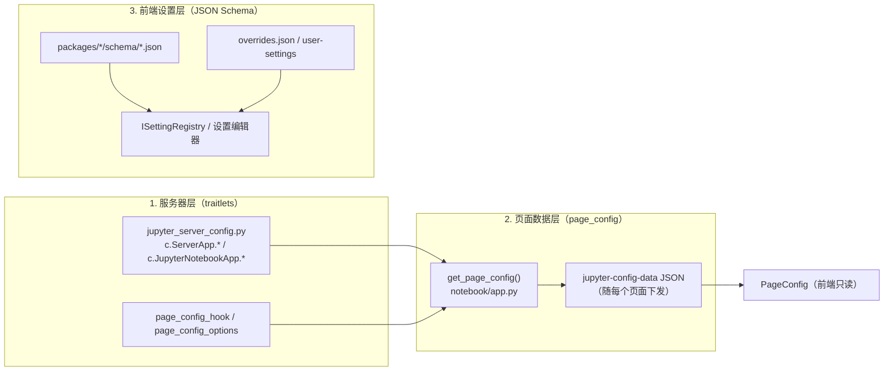

# 配置系统详解

Notebook v7 的配置分布在三个层次：Python 服务器层（traitlets 配置文件）、页面数据层（`page_config`，随 HTML 下发的前端引导数据）、前端设置层（基于 JSON Schema 的插件设置系统）。改对层次，配置才能生效。

## 服务器层（traitlets 配置文件）

配置文件走 Jupyter 通用体系：`jupyter server --generate-config` 生成 `~/.jupyter/jupyter_server_config.py`，配置目录由 `jupyter_core` 的路径规则决定（`JUPYTER_CONFIG_DIR` 可覆盖）。与本仓库直接相关的命名空间：

| 配置项 | 类型/默认 | 说明 |
| --- | --- | --- |
| `c.ServerApp.default_url` | str | 整站默认页；扩展的 `/tree` 是 `JupyterNotebookApp.default_url` 的值，ServerApp 层可改 |
| `c.JupyterNotebookApp.default_url` | `"/tree"` | notebook 扩展的默认跳转目标 |
| `c.JupyterNotebookApp.custom_css` | `True` | 是否加载自定义 CSS（等价旗标 `--custom-css`；关闭用 `--JupyterNotebookApp.custom_css=False`） |
| `c.JupyterNotebookApp.expose_app_in_browser` | `False` | 暴露 `window.jupyterapp` |
| `c.ServerApp.page_config_options` | dict | 向 page_config 注入任意键值的标准通道（如 `disabledExtensions`） |
| `page_config_hook` | callable | settings 中的钩子，`get_page_config()` 最后一步回调，可编程改写整个 page_config |

v6 兼容：`JupyterNotebookApp` 经 `notebook_shim` 的 mixin 接受一批 v6 时代的配置项（MathJax、终端可用性等）并转换到新语义。注意 v7 移除了 `notebook.auth`、`notebook.notebookapp` 等旧导入路径（[docs/source/configuring/config_overview.md](../docs/source/configuring/config_overview.md) 有迁移说明）。

## 页面数据层（page_config）

生成链路：[notebook/app.py](../notebook/app.py) 的 `NotebookBaseHandler.get_page_config()` 汇总各来源（详见 [03-后端模块详解](03-后端模块详解.md)）→ Jinja2 把结果写入页面 `<script id="jupyter-config-data">`（模板同时合并 `baseUrl`/`wsUrl`，并写入 `notebookPage` 页面哨兵）→ 前端 `PageConfig.getOption(key)` 只读消费。

关键键值速查：

| 键 | 含义 | 前端消费方示例 |
| --- | --- | --- |
| `notebookPage` | 当前页面标识（tree/notebooks/consoles/edit/terminals），模板注入 | [index.template.js](../app/index.template.js) 装配分支；menus/`pages` 插件的页面裁剪 |
| `baseUrl` / `wsUrl` | REST 与 WebSocket 地址 | `ServiceManager.serverSettings` |
| `token` | 鉴权 token（JupyterHub 场景被刻意清空） | 请求头 |
| `appVersion` / `appVersionSlug` 等 | 版本信息 | About 对话框、`NotebookApp.version` |
| `federated_extensions` | 已安装预构建扩展清单 | 动态加载联邦扩展 |
| `nbclassic_enabled` | nbclassic 服务器扩展是否启用 | 界面切换器选项 |
| `hubPrefix`/`hubUser`/`shareUrl` | JupyterHub 环境（`initialize_handlers` 注入） | `paths.urls`、分享链接 |
| `terminalsAvailable`、MathJax 配置、各 `*Dir` 目录 | 能力开关与路径 | 终端插件、渲染器、设置编辑器 |
| `disabledExtensions` | 禁用清单（id 或包名） | `PageConfig.Extension.disabled` |

修改这一层的正规方式只有两种：服务器配置（`page_config_options` 或 traitlets，因为多数 `*_url`/`*Dir` 键源自 LabConfig trait）或 `page_config_hook`。

## 前端设置层（JSON Schema 插件设置）

每个插件的设置项由其包内 `schema/<插件名>.json` 声明，构建时安装到 `share/jupyter/lab/schemas/@jupyter-notebook/<包>/`。运行时读取链：`ISettingRegistry.load(插件id)` → 返回 `ISettings`，用 `settings.get(key).composite` 取"用户值 + overrides + schema 默认值"合成结果，`settings.changed` 信号响应修改（完整模式见 [09-扩展开发指南](09-扩展开发指南.md) 范例三）。[application-extension/src/settingconnector.ts](../packages/application-extension/src/settingconnector.ts) 把该注册表与 jupyterlab_server 的设置 REST API 打通，使设置可持久化到服务器并在设置编辑器中展示。

三个写入位置，优先级从低到高：

| 位置 | 路径 | 用途 |
| --- | --- | --- |
| Schema 默认值 | 包内 `schema/*.json` 的 `default` | 出厂默认 |
| 系统覆盖 | JupyterLab app 设置目录下 `overrides.json` | 管理员强制默认值（Tree 页设置编辑器可视化编辑的就是它） |
| 用户设置 | `user-settings/@jupyter-notebook/<包>/<插件>.jupyterlab-settings` | 个人偏好，JSON 格式 |

schema 还承载两项声明式能力（无需写代码）：

- **菜单注入**：`jupyter.lab.menus` 字段把命令挂进指定菜单，如 [schema/zen.json](../packages/application-extension/schema/zen.json) 向 View 菜单添加 `application:toggle-zen`；
- **布局覆盖**：[schema/shell.json](../packages/application-extension/schema/shell.json) 定义 `layout` 映射（部件名 → `{area, options}`），出厂默认把 Debugger Console 放到 `down` 区、Markdown Preview 放 `right` 区、Plugins 放 `left` 区。用户在设置编辑器改 `layout` 即可移动部件位置，`NotebookShell.add` 会优先采纳（见 [05-关键类与函数](05-关键类与函数.md)）。

## 自定义 CSS

`CustomCssHandler` 服务于 `{base_url}/custom/custom.css`，按顺序取 `~/.jupyter/custom/custom.css`，不存在则回退静态目录旁的 `custom/` 目录。页面模板仅在 `custom_css` 为真时引入该样式表，因此彻底关闭的写法是 `--JupyterNotebookApp.custom_css=False`。

## 常见配置场景对照

| 想做什么 | 改哪里 |
| --- | --- |
| 改打开 `/` 时的默认页 | `c.ServerApp.default_url`（或 `c.JupyterNotebookApp.default_url`） |
| 换 MathJax 地址 | `c.NotebookApp.mathjax_url`（notebook_shim 兼容项，page_config 层生效） |
| 禁用某个内置/联邦插件 | `page_config_options` 注入 `disabledExtensions` |
| 调整侧栏/底部面板部件位置 | 设置编辑器中改 `@jupyter-notebook/application-extension:shell` 的 `layout`（或写 overrides.json） |
| 全站强制某插件默认值 | app 设置目录 `overrides.json` |
| 改 page_config 中无对应 trait 的键 | `page_config_hook` 编程改写 |
| 隐藏顶部栏/Zen 模式 | 前端设置 `@jupyter-notebook/application-extension:top` / `:zen`（也可用 `application:toggle-zen` 命令即时切换） |
